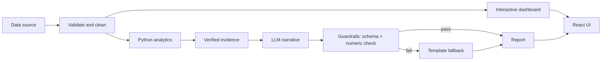

# Power BI Narrative Generator

**Turn your data into insightful, human-readable business reports with AI.**

 [](https://power-bi-report-generator.vercel.app)

An AI analytics app that explores datasets in a Power BI-style dashboard, detects trends and anomalies, and writes a business narrative. Python computes every number; the LLM only writes the words; guardrails verify the result.

🎥 **Project Demo**

[](https://youtu.be/1p_BsG5Cwf0)

[🎥 Watch Demo](https://youtu.be/1p_BsG5Cwf0) · [📂 Source Code](https://github.com/adolui-2002/POWER-BI-REPORT-GENERATOR)

## Features

- **Data sources:** CSV, TSV, Excel, JSON, JSONL, XML, Parquet, SQLite, URLs, read-only SQL (API)
- **Interactive dashboard:** slicers, cross-filtering, month drill-down, matrix heatmap, sortable data table, CSV export
- **Analytics:** monthly trends, category breakdowns, z-score anomalies, correlation
- **AI report builder:** executive/analyst modes, report for the filtered view, editable sections, live number verification, Markdown/PDF export
- **Guardrails:** upload limits, SSRF block, SELECT-only SQL, PII scan, prompt-injection filtering, numeric-claim check with template fallback

## Tech Stack

FastAPI · Pandas/NumPy · Ollama (**Qwen3 8B**) · React + Vite + Recharts · Pydantic · pytest · Docker

## Architecture



## Getting Started

**Prerequisites:** Python 3.10+, Node.js 18+, [Ollama](https://ollama.com) (optional; without it a template narrative is used)

```bash
git clone https://github.com/adolui-2002/POWER-BI-REPORT-GENERATOR.git
cd POWER-BI-REPORT-GENERATOR

# LLM (optional, ~5 GB)
ollama pull qwen3:8b

# Backend
cd backend
python -m venv .venv
.venv\Scripts\Activate.ps1        # macOS/Linux: source .venv/bin/activate
pip install -r requirements.txt
uvicorn app.main:app --reload     # API docs: http://127.0.0.1:8000/docs

# Frontend (new terminal)
cd frontend
npm install
npm run dev                       # http://localhost:5173
```

Try it with `sample_data/sales_data.csv` (600 synthetic rows, also in 7 other formats).

**Docker:** `docker compose up --build`, then `docker compose exec ollama ollama pull qwen3:8b`

Settings (`.env.example`): `OLLAMA_MODEL`, `OLLAMA_URL`, `LLM_TIMEOUT`, `MAX_UPLOAD_MB`, `CORS_ORIGINS`.

## Testing and Evaluation

```bash
cd backend && pytest -q
cd .. && python evaluation/run_evaluation.py
```

| Check | Result |
| --- | --- |
| pytest suite | 18 / 18 passed |
| 8 file formats: exact totals, numeric check, sections | 8 / 8 passed |
| Median latency (template narrative, no LLM) | about 0.01 s |


## Limitations

- Qwen3 8B needs about 8 GB RAM/VRAM and can be slow on CPU
- Numeric check verifies numbers, not stated causes
- Data is stored in memory (lost on restart)
- No PDF/OCR or cloud-warehouse connectors yet; not deployed yet

## Roadmap

Cloud deployment · PDF/OCR · more connectors · authentication and persistence · larger human-rated benchmark

## Contributing

Issues and pull requests are welcome. Run `pytest -q` before submitting.

## License

MIT. See `LICENSE`.
